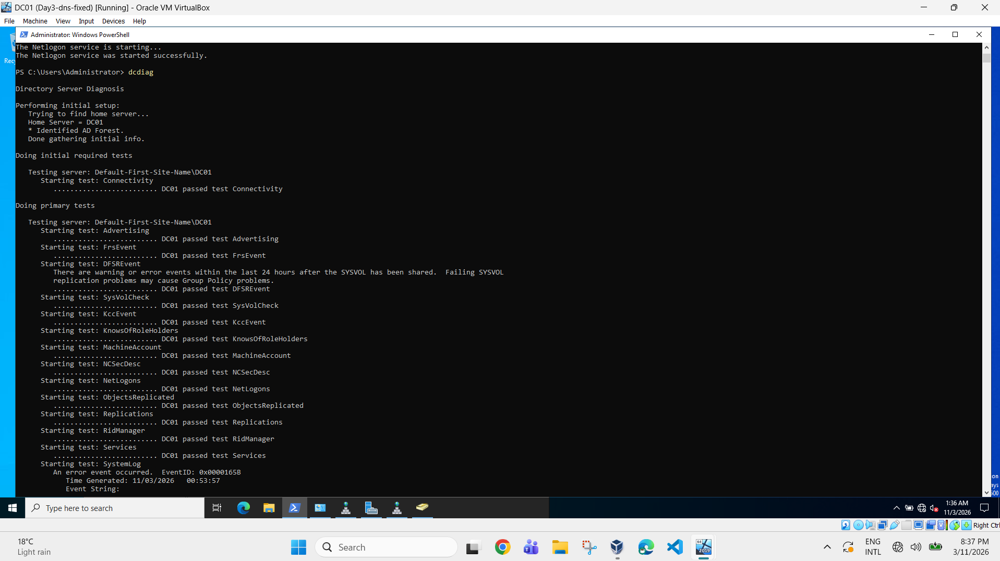
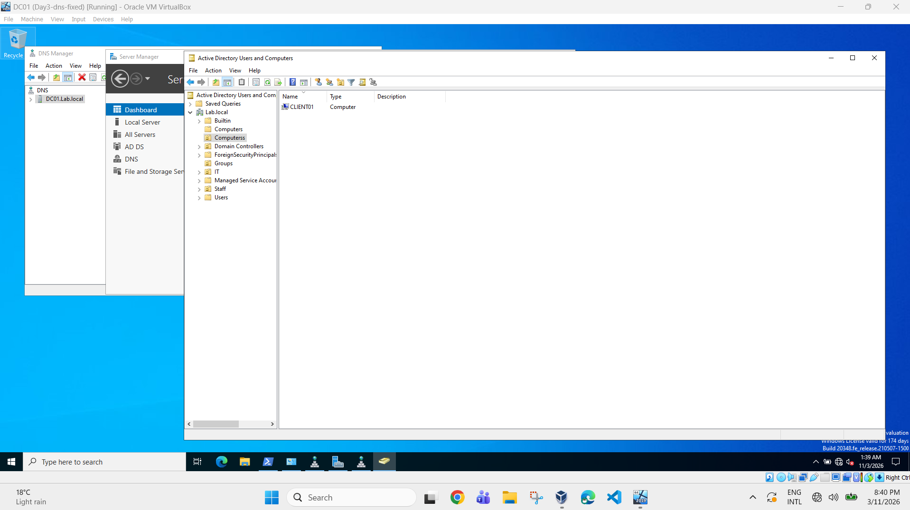
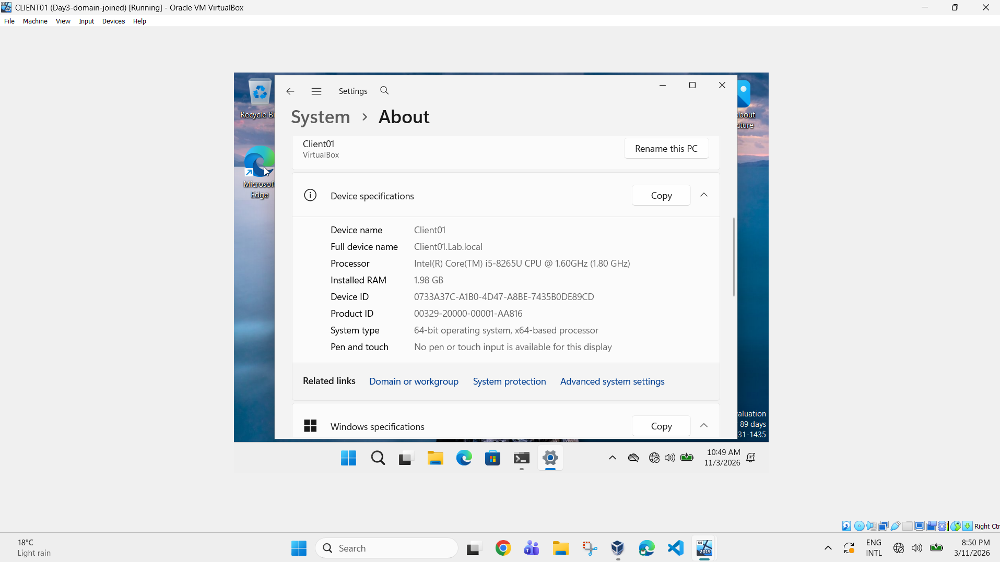
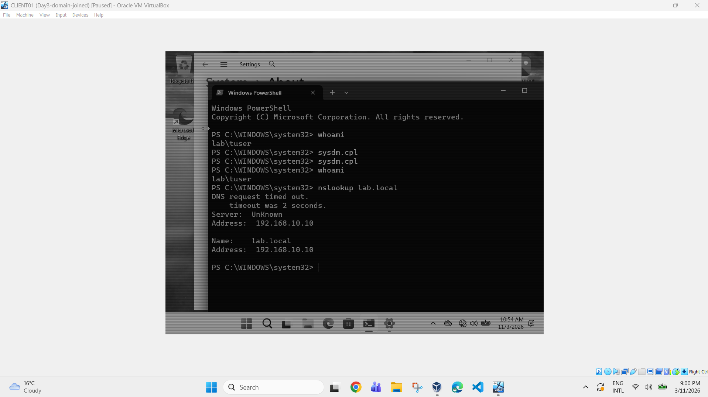

# Active Directory Home Lab

A Windows Server 2022 and Windows 11 lab built in Oracle VirtualBox to practise Active Directory, DNS and domain administration. I'm building it to develop practical IT support skills, and I'm adding to it as I go.

## Goal

Build a small domain environment from scratch, then break and fix it on purpose to learn how identity, DNS and client machines fit together. This lab will later be extended to Microsoft Entra ID, Intune and Microsoft 365 (hybrid identity).

## Environment

| Item | Detail |
|---|---|
| Hypervisor | Oracle VirtualBox 7 |
| Domain controller | `DC01`, Windows Server 2022 Standard (Desktop Experience), evaluation edition |
| Client | `CLIENT01`, Windows 11 Enterprise, evaluation edition |
| Domain | `lab.local` (new forest) |
| Lab network | VirtualBox NAT Network `LabNet`, `192.168.10.0/24` |
| DC address | `192.168.10.10` (static) |
| Internet access | Second adapter on plain NAT for each VM |
| Host | Laptop with 8 GB RAM, so each VM runs on about 2 GB |

## Build log

### Day 1: Lab setup
- Created the `LabNet` NAT Network and the `DC01` VM.
- Installed Windows Server 2022 and the VirtualBox Guest Additions.
- Renamed the server to `DC01` and set a static IP address.
- Took a snapshot before making any bigger changes.

### Day 2: Domain controller
- Installed the AD DS role and promoted `DC01` to a domain controller for the new forest `lab.local`.
- Checked health with `dcdiag` and confirmed the `SYSVOL` and `NETLOGON` shares exist.
- Created OUs (`IT`, `Staff`, `Computers`, `Groups`), a test user (`tuser`) and a `HelpDesk` security group.
- Verified the objects with PowerShell (`Get-ADUser`, `Get-ADGroupMember`).

### Day 3: Joining a client
- Built a Windows 11 client (`CLIENT01`) and pointed its DNS at the domain controller.
- Tested with `ping` and `nslookup lab.local` before joining.
- Joined `CLIENT01` to `lab.local`, signed in as a domain user and moved the computer account into the Computers OU.

## Troubleshooting notes

### 1. No internet on the NAT Network
- **Symptom:** `ping 8.8.8.8` returned "Destination host unreachable" from the server's own address.
- **Diagnosis:** The IP, mask, gateway and DNS settings were correct, and DHCP gave a working address, so the fault was in the virtual network, not the settings.
- **Fix:** Added a second adapter on plain NAT for internet access and left the lab adapter without a default gateway.

### 2. Domain name resolving to two addresses
- **Symptom:** `nslookup lab.local` on the client returned both `192.168.10.10` and `10.0.3.15`.
- **Cause:** The domain controller's second (internet) adapter had registered its own address in DNS, so a client could be sent to the wrong one.
- **Fix:** Turned off DNS registration on that adapter, deleted the wrong record from the `lab.local` zone, restricted the DNS server to listen on `192.168.10.10` only, and refreshed with `ipconfig /registerdns` and `ipconfig /flushdns`.
- **Lesson:** A domain join depends on DNS. If DNS is wrong, the join fails.

### 3. Harmless warnings
- `dcdiag` showed a `DFSREvent` warning right after promotion. This is normal on a new domain controller, and `SysVolCheck` passed.
- `nslookup` shows "DNS request timed out" and "Server: Unknown" because the lab has no reverse lookup zone. Forward lookups work correctly.

### 4. Running two VMs on 8 GB of RAM
- **Symptom:** The laptop froze when both VMs started.
- **Fix:** Reduced each VM to about 2 GB, closed other programs and started `DC01` first.

## Screenshots

**Domain controller health (`dcdiag`)**

**OU structure in Active Directory Users and Computers**

**Client joined to `lab.local`**

**Signed in as a domain user**

**DNS resolving `lab.local` to a single address**

## What I learned

- How a domain controller, DNS and a client fit together, and why DNS is the first thing to check when a join fails.
- Reading `ipconfig`, `ping`, `nslookup` and `dcdiag` output, and telling real faults from harmless warnings.
- Organising users, computers and groups with OUs, and moving objects between them.
- Using snapshots to make risky changes safely.

## Next steps

- Group Policy: create and test GPOs for a user OU
- Password and account lockout policies, and troubleshooting lockouts
- Microsoft Entra ID and Entra Connect (hybrid identity)
- Intune enrolment and compliance policies
- Microsoft Graph PowerShell for bulk user reports

## About

Built by Prasanna Shrestha, Master of Information Technology graduate (Cyber Security).
GitHub: [prasannashrestha24](https://github.com/prasannashrestha24)
